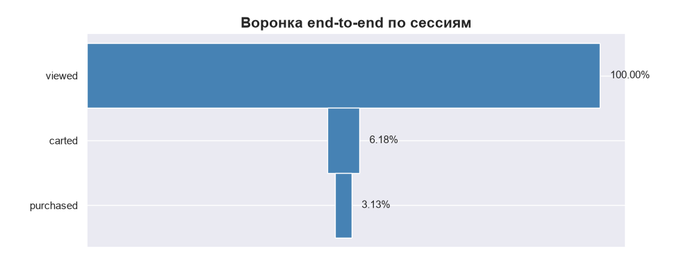
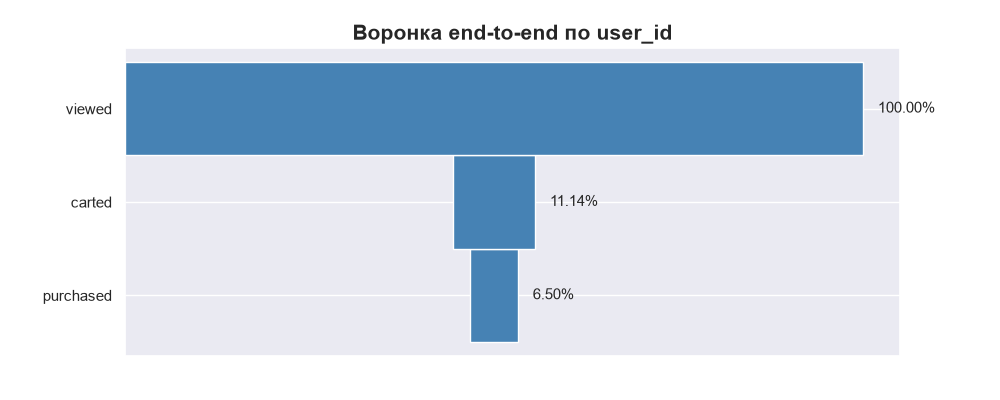
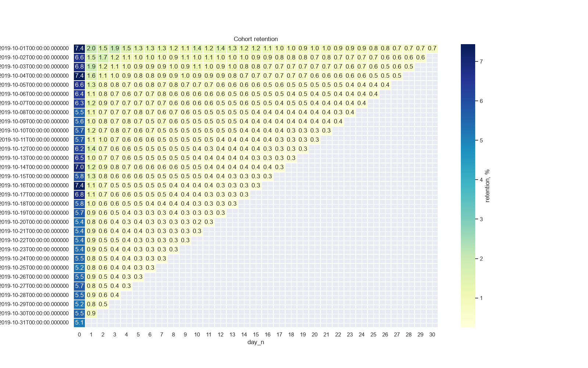
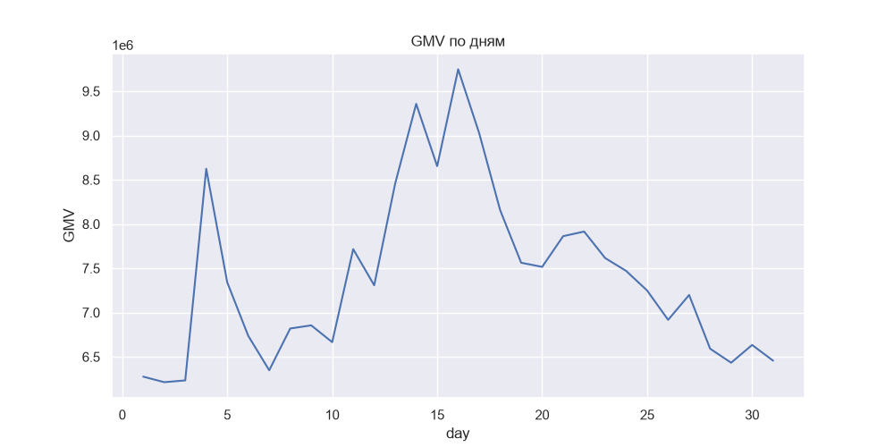

# E-commerce EDA & Retention Analysis

EDA поведения пользователей e-commerce за октябрь 2019
(Kaggle «eCommerce behavior data»). Цель — разобрать воронку,
retention и драйверы GMV.

## TL;DR

- **$230M GMV** за месяц, **3,02M** пользователей, **9,24M** сессий.
- **Воронка:** view→cart 6,2% (сессии) / 11,1% (юзеры); cart→purchase 50,7% / 58,3%.
- **Retention:** D1 = 2,0%, но **windowed D30 = 20,1%** — окно возврата широкое.
- **Всплеск W42 (+17,2% GMV) — трафиковый, не ценовой:** orders +11,7%, UPT не изменился.

## Данные

- Источник: [Kaggle — eCommerce behavior data](https://www.kaggle.com/datasets/mkechinov/ecommerce-behavior-data-from-multi-category-store)
- 42 448 764 строк
- 1–31 октября 2019
- 3 022 290 уникальных пользователей
- 9 244 421 уникальных сессий

## Стек

Python, DuckDB (основные агрегации на 42M строк), pandas, matplotlib, seaborn, NumPy.

## Ключевые инсайты

### Воронка

| Этап | По сессиям | По пользователям |
|---|---:|---:|
| view | 9 242 653 | 3 022 130 |
| cart | 571 061 | 336 812 |
| purchase | 289 507 | 196 505 |
| **view → cart** | **6,18%** | **11,14%** |
| **cart → purchase** | **50,70%** | **58,34%** |

Разница между сессиями и юзерами — не баг: часть пользователей
добавляет в корзину в одной сессии, а покупает в следующей.
**94% сессий не доходят до корзины** — главная точка роста.




### Retention

Когорта — пользователи, впервые сделавшие `view` 1 октября.

| Метрика | D1 | D7 | D30 |
|---|---:|---:|---:|
| Exact-day | 2,03% | 1,26% | 0,73% |
| Windowed (кумулятивно) | 8,58% | 12,70% | **20,11%** |
| Rolling (после дня N) | 15,35% | 11,89% | — |

Exact D1 в 2% — норма для маркетплейса с редкими покупками.
Ключевая цифра — **20% пользователей покупают хотя бы раз в течение месяца**.



### Всплеск 42-й недели (13–20 октября)

Декомпозиция `GMV = orders × AOV`, `AOV = UPT × avg_item_price`:

| Неделя | Orders | GMV | AOV | UPT | Avg item price |
|---:|---:|---:|---:|---:|---:|
| 41 | 144 619 | $50,17M | $346,92 | 1,18 | $294,52 |
| **42** | **160 964** | **$60,02M** | **$372,86** | **1,18** | **$315,72** |
| 43 | 143 491 | $52,23M | $363,98 | 1,18 | $308,55 |
| **Lift W42** | **+11,7%** | **+17,2%** | **+4,9%** | **≈0%** | **+4,9%** |

**UPT не изменился** — люди не стали покупать больше позиций за сессию.
**~68% прироста GMV — трафик**, **~28% — сдвиг в дорогие товары**.
Это не промо-кампания, а рост числа purchase-сессий.



### Аномалии в данных

- **`price = 0`** у 68 523 `view`-событий, у 150 `cart` и **ни у одного `purchase`**.
  Похоже на баг пайплайна на этапе `view` — на GMV не влияет,
  но требует проверки источника.
- **`category_code` пуст у 31,8% событий**, `brand` — у 14,4%.
  Категорийный анализ покрывает только ~68% покупок.

## Ограничения анализа

- **Cohort day 0** включает покупки в день первого `view`, в том числе возможные
  покупки до него (сравнение по дате, а не по timestamp).
- **Недели 40 и 44 неполные** — исключены из недельных сравнений.

## Структура

```text
.
├── eda.ipynb
├── README.md
├── img/
│   ├── heatmap.png
│   ├── session_funnel.png
│   ├── users_funnel.png
│   └── gmv.png
└── .gitignore
```

## Roadmap

- [x] Session / user funnel
- [x] Retention: exact, windowed, rolling
- [x] Cohort heatmap
- [x] Аномалии: `price = 0`, nulls
- [x] DAU / WAU / MAU, Sticky Factor
- [x] GMV / AOV / декомпозиция W42

## Автор

Константин Альховский [@Alkhovskii](https://t.me/Alkhovskii)